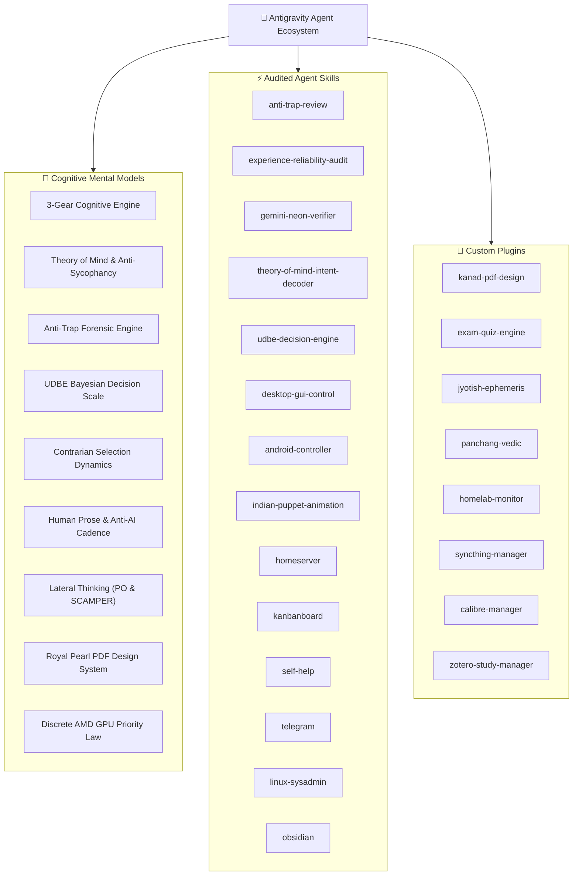

# 🚀 Antigravity Skills & Mental Models Ecosystem

[](https://opensource.org/licenses/MIT)
[](https://deepmind.google)
[](#-mental-models-and-cognitive-frameworks)

A production-grade collection of **custom AI agent skills, mental models, cognitive rules, and specialized plugins** designed and battle-tested by Kanad Samanta ([@Kanad590](https://github.com/Kanad590)) and Antigravity.

Built for autonomous execution, anti-sycophantic decision audits, forensic commercial reviews, deep cross-project verification, and robust Linux desktop automation.

---

## 🏛️ System Architecture



---

## 🧠 Mental Models Catalog (`mental-models/`)

| # | Mental Model | Description |
| :-: | :--- | :--- |
| **01** | [**3-Gear Cognitive Engine**](mental-models/01_3_gear_cognitive_engine.md) | Dynamic reasoning allocation (Sprint, Craft, Deep Mind) to suppress latency and prevent prompt bloat. |
| **02** | [**Cultural Theory of Mind**](mental-models/02_ashlesha_rahu_theory_of_mind.md) | Latent intent decoding and constructive disagreement standard (unvarnished truth over polite flattery). |
| **03** | [**Anti-Trap Forensic Audit**](mental-models/03_anti_trap_forensic_audit.md) | Dual-Set (Industry Norm vs Deceptive Exception) calibration and hard veto gates for commercial offers. |
| **04** | [**UDBE Decision Engine**](mental-models/04_udbe_bayesian_decision_engine.md) | Competence-integrity decoupling, contrastive synthetic falsification, and Boolean veto cliffs. |
| **05** | [**Contrarian Selection Dynamics**](mental-models/05_el_farol_crowded_trade_strategy.md) | Anti-corpus anchoring and deterministic scoring priority to escape hyper-competitive crowded trades. |
| **06** | [**Human Voice Engineering**](mental-models/06_human_cadence_and_clarity.md) | Eliminates 21 robotic AI patterns and enforces direct, authentic human cadence in English and Bengali. |
| **07** | [**Lateral Thinking & PO**](mental-models/07_divergent_creative_engineering.md) | Provocative operations (PO) and SCAMPER divergent matrices to escape algorithmic local minima. |
| **08** | [**Royal Pearl PDF Design**](mental-models/08_royal_pearl_pdf_design_system.md) | Warm Ivory, Deep Teal, and Champagne Gold visual typography with automated visual verification QA. |
| **09** | [**Discrete AMD GPU Priority**](mental-models/09_discrete_amd_gpu_priority.md) | Dedicated GPU hardware acceleration (`DRI_PRIME=1`) for 3D, animation, and video rendering workloads. |

---

## ⚡ Agent Skills Catalog (`skills/`)

All skills include standardized `SKILL.md` runbooks, executable CLI scripts, reference documentation, and zero-secret sanitization:

1. **`anti-trap-review`**: 13-Factor Forensic Review & Scoring Engine for online courses, SaaS, and apps.
2. **`experience-reliability-audit`**: Multi-source offline vendor, local shop, and second-hand seller audit framework.
3. **`gemini-neon-verifier`**: Google Gemini Web 4 Neon verification and anti-blind-dumping cross-checker.
4. **`theory-of-mind-intent-decoder`**: Cognitive Theory of Mind and cultural pragmatic emotion decoder.
5. **`udbe-decision-engine`**: Universal Dynamic Bayesian Scale & Evidence-Weighted Evaluation Engine (v3.6).
8. **`desktop-gui-control`**: Pop!_OS COSMIC Wayland native GUI automation, typing, and zero-hang screenshotting.
9. **`android-controller`**: Native ADB automation, wireless debugging, and scrcpy live desktop mirroring.
10. **`indian-puppet-animation`**: 2D Cutout Kathputli and shadow puppet animation reel generator.
11. **`homeserver`**: Raspberry Pi homeserver management, Docker compose stacks, and background service maintenance.
12. **`kanbanboard`**: Kanboard automation CLI and exam tracking engine.
13. **`self-help`**: Personal growth, cognitive mastery, exam preparation, and accountability drilling.
14. **`telegram`**: Telegram assistant bot integration and automated notification sentinel.
15. **`linux-sysadmin`**: Defensive bash scripting, Linux administration, and systemd service management.
16. **`obsidian`**: Obsidian vault architecture, Dataview DQL, Canvas mind-maps, and link auditing.

---

## 🔌 Custom Plugins Catalog (`plugins/`)

* **`kanad-pdf-design`**: Global default Royal Pearl PDF design system with Headless Chrome renderer.
* **`exam-quiz-engine`**: Active recall MCQ quiz generator and flashcard extraction engine with anti-corpus rules.
* **`jyotish-ephemeris`**: Sidereal Vedic astrology calculations matching Jagannatha Hora (Lahiri Ayanamsha).
* **`panchang-vedic`**: Daily Vedic Panchanga, Tithi, Nakshatra, Yoga, and Muhurta calculations.
* **`homelab-monitor`**: Homeserver telemetry, temperature, storage health, and alert dispatch.
* **`syncthing-manager`**: Continuous device sync verification and conflict resolution daemon.
* **`calibre-manager`**: Calibre e-book library curation, metadata extraction, and indexing.
* **`zotero-study-manager`**: Local Zotero bibliographic search, study question paper retrieval, and PDF reading.

---

## 🚀 Installation & Usage

### 1. Install Entire Suite into Google Antigravity / Agents
Clone the repository into your global or local agent skills directory:

```bash
git clone https://github.com/Kanad590/antigravity-skills.git ~/.gemini/config/skills/antigravity-ecosystem
```

Or symlink specific skills directly:
```bash
ln -s ~/antigravity-skills/skills/anti-trap-review ~/.gemini/config/skills/anti-trap-review
ln -s ~/antigravity-skills/skills/gemini-neon-verifier ~/.gemini/config/skills/gemini-neon-verifier
```

### 2. Standalone CLI Tools
Individual skills contain standalone Python CLI utilities:

```bash
# Run Anti-Trap Forensic Review
python3 skills/anti-trap-review/scripts/anti_trap_calc.py --demo

# Run UDBE Decision Engine Evaluation
python3 skills/udbe-decision-engine/scripts/evaluate.py

# Run Neon Payload Builder
python3 skills/gemini-neon-verifier/scripts/neon_payload_builder.py input.pdf "Analyze structural risks"
```

---

## 🛡️ Security & Privacy Audit Standard

Every component in this repository is strictly sanitized under the **Zero-Secret Commitment**:
* ❌ Zero private credentials, bot tokens, or API keys.
* ❌ Zero private addresses, phone numbers, or identity numbers.
* ❌ Zero hardcoded private IP addresses; all endpoints are configurable via environment variables.

---

## 📄 License

This repository is open-sourced under the [MIT License](LICENSE).
