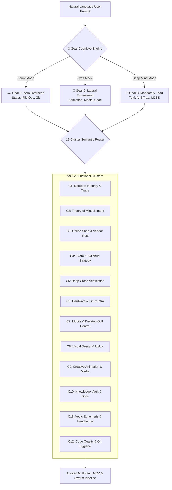

# 🚀 Antigravity Skills & Mental Models Ecosystem

[](LICENSE)
[](https://deepmind.google)
[](#-mental-models-and-cognitive-frameworks)
[](#-100-case-empirical-validation-benchmark)

A production-grade collection of **custom AI agent skills, mental models, cognitive rules, and specialized plugins** designed and battle-tested by Kanad Samanta ([@Kanad590](https://github.com/Kanad590)) and Antigravity.

Built for autonomous multi-agent swarms, anti-sycophantic decision audits, forensic commercial reviews, deep cross-project verification, and robust Linux desktop automation.

---

## 🏛️ System Architecture



---

## 📊 100-Case Empirical Validation Benchmark

The cognitive routing atlas was rigorously validated across **100 independent real-world scenarios** spanning all 12 functional clusters:

| Metric | Measured Score | Benchmark Target | Verdict |
| :--- | :---: | :---: | :---: |
| **Cognitive Gear Accuracy** | **98.00%** | >= 90.00% | ✅ Passed |
| **Functional Cluster Accuracy** | **99.00%** | >= 90.00% | ✅ Passed |
| **Skill Recall Fidelity** | **97.33%** | >= 90.00% | ✅ Passed |
| **MCP Server Recall Fidelity** | **99.00%** | >= 90.00% | ✅ Passed |
| **Deterministic Verdict Match** | **100.00%** | >= 90.00% | ✅ Passed |
| **Overall Mean Composite Fidelity** | **98.87%** | >= 90.00% | ✅ Passed |

*Detailed benchmark dataset, scoring harness, and full breakdown are available in [`benchmarks/`](benchmarks/).*

---

## 🛠️ Standalone Cognitive Router CLI

Route any prompt to its optimal cognitive gear, functional cluster, and toolchain instantly:

```bash
# Basic terminal classification
./bin/cognitive-router "Is this online coding bootcamp an autopay scam trap?"

# JSON output mode for programmatic integrations
./bin/cognitive-router --json "Audit my git repo before pushing to github"
```

---

## 🧠 Mental Models and Cognitive Frameworks (`mental-models/`)

The repository codifies 11 core mental models that guide AI reasoning, strategic allocation, and multi-agent coordination:

1. **[`01_3_gear_cognitive_engine.md`](mental-models/01_3_gear_cognitive_engine.md)**: Dynamic compute allocation across Sprint (Gear 1), Craft (Gear 2), and Deep Mind (Gear 3) modes.
2. **[`02_ashlesha_rahu_theory_of_mind.md`](mental-models/02_ashlesha_rahu_theory_of_mind.md)**: Cognitive Theory of Mind, cultural intent decoding, and hidden motive analysis.
3. **[`03_anti_trap_forensic_audit.md`](mental-models/03_anti_trap_forensic_audit.md)**: 13-Factor forensic audit detecting commercial lock-in, recurring traps, and false claims.
4. **[`04_udbe_bayesian_decision_engine.md`](mental-models/04_udbe_bayesian_decision_engine.md)**: Universal Dynamic Bayesian Scale & Evidence-Weighted evaluation engine.
5. **[`05_el_farol_crowded_trade_strategy.md`](mental-models/05_el_farol_crowded_trade_strategy.md)**: Anti-crowd contrarian reasoning and game-theoretic differentiation.
6. **[`06_human_cadence_and_clarity.md`](mental-models/06_human_cadence_and_clarity.md)**: Authentic human prose cadence eliminating 43 robotic AI patterns.
7. **[`07_divergent_creative_engineering.md`](mental-models/07_divergent_creative_engineering.md)**: Lateral thinking protocols based on Edward de Bono's frameworks (PO, SCAMPER).
8. **[`08_royal_pearl_pdf_design_system.md`](mental-models/08_royal_pearl_pdf_design_system.md)**: High-typography publishing system optimized for dark-mode readability.
9. **[`09_discrete_amd_gpu_priority.md`](mental-models/09_discrete_amd_gpu_priority.md)**: Workstation acceleration rules prioritizing dedicated GPU pipelines (`DRI_PRIME`).
10. **[`10_12_cluster_routing_atlas.md`](mental-models/10_12_cluster_routing_atlas.md)**: Comprehensive mapping of 137+ tools across 12 mutually exclusive cognitive clusters.
11. **[`11_kanad_monastic_consensus_swarm.md`](mental-models/11_kanad_monastic_consensus_swarm.md)**: Universal Tri-Party Democratic Governance (Manager, Worker, Analyser, Monitor), Hardware-Anchored Reality (Intel HD 520 / 60fps), and Monastic Zero-Data-Loss Processing Model for AI Swarms.

---

## ⚡ Skills Catalog (`skills/`)

### Multi-Agent Swarms & Democratic Governance
* **[`kanad-consensus-swarm`](skills/kanad-consensus-swarm/SKILL.md)**: The definitive, universal multi-agent swarm governance standard. Enforces institutional separation of powers (**🧭 Manager**, **🛠️ Worker**, **🔬 Analyser**, **🛡️ Monitor**), democratic consensus voting (2/3 majority or 3/3 unanimous ratification), hardware fill-rate protection (Intel HD 520, zero `backdrop-filter: blur()`, locked 60fps), and the monastic "Zero Question Missed" zero-data-loss processing model.
  * 🗳️ [Voting Consensus Protocol](skills/kanad-consensus-swarm/references/voting_consensus_protocol.md)
  * 💻 [Hardware-Anchored Reality Protocol](skills/kanad-consensus-swarm/references/hardware_anchored_audit.md)
  * 👥 [Separation of Powers & RACI Matrix](skills/kanad-consensus-swarm/references/separation_of_powers_matrix.md)
  * 🏆 [Dual-Vault Evolution Case Study](skills/kanad-consensus-swarm/references/case_study_dual_vault_evolution.md)

### Core Decision & Verification Skills
* **`anti-trap-review`**: 13-Factor forensic review & dual-set scoring engine for digital products, courses, and SaaS.
* **`experience-reliability-audit`**: 8-Signal offline vendor and local shop trust evaluation framework.
* **`gemini-neon-verifier`**: Google Gemini Web 4 Neon cross-project verification and anti-blind-dumping engine.
* **`theory-of-mind-intent-decoder`**: Cognitive Theory of Mind and cultural pragmatic emotion decoder.
* **`udbe-decision-engine`**: Universal Dynamic Bayesian Scale & Evidence-Weighted Evaluation Engine (v3.6).
* **`anti-sycophancy`**: Eliminates sycophantic agreement and unearned flattery in AI evaluations.
* **`audit-agent-run-evidence`**: Independent evidentiary auditing of multi-step agent execution traces.

### Automation, Infrastructure & System Skills
* **`desktop-gui-control`**: Pop!_OS COSMIC Wayland native GUI automation, typing, and zero-hang screenshotting.
* **`android-controller`**: Native ADB automation, wireless debugging, and scrcpy live desktop mirroring.
* **`homeserver`**: Raspberry Pi homeserver management, Docker compose stacks, and background service maintenance.
* **`linux-sysadmin`**: Defensive bash scripting, Linux administration, and systemd service management.
* **`kanbanboard`**: Kanboard automation CLI and exam tracking engine.
* **`telegram`**: Telegram assistant bot integration and automated notification sentinel.

### Content, Design & Code Quality Skills
* **`indian-puppet-animation`**: 2D Cutout Kathputli and shadow puppet animation reel generator.
* **`avoid-ai-writing`**: Eliminates 21 robotic AI patterns with 43-word precision replacement in English and Bengali.
* **`brainstorming`**: Lateral thinking and divergent synthesis protocols based on Edward de Bono's frameworks.
* **`obsidian`**: Obsidian vault architecture, Dataview DQL, Canvas mind-maps, and link auditing.
* **`codebase-audit-pre-push`**: Deep pre-push codebase audit: removes junk files, dead code, and security risks.
* **`broken-link-finder`**: Fast link auditing and dead reference detection.
* **`deep-research`**: Autonomous multi-turn research, source synthesis, and report generation.
* **`notebooklm`**: Browser automation bridge for grounded NotebookLM research workflows.
* **`self-help`**: Personal growth, cognitive mastery, exam preparation, and accountability drilling.

---

## 🔌 Custom Plugins Catalog (`plugins/`)

* **`kanad-pdf-design`**: Global default Royal Pearl PDF design system with Headless Chrome renderer.
* **`exam-quiz-engine`**: Active recall MCQ quiz generator and flashcard extraction engine with anti-corpus rules.
* **`jyotish-ephemeris`**: Sidereal Vedic astrology calculations matching Jagannatha Hora (Lahiri Ayanamsha).
* **`panchang-vedic`**: Daily Vedic Panchanga, Tithi, Nakshatra, Yoga, and Muhurta calculations.
* **`homelab-monitor`**: Homeserver telemetry, temperature, storage health, and alert dispatch.
* **`syncthing-manager`**: Continuous device sync verification and conflict resolution daemon.
* **`calibre-manager`**: Calibre e-book library curation, metadata extraction, and indexing.
* **`zotero-study-manager`**: Local Zotero bibliographic search, study question paper retrieval, and PDF reading.

---

## 📜 Third-Party Attributions & Open-Source Licenses

> [!IMPORTANT]
> **Zero Unearned Credit Commitment:**  
> The maintainer of this repository, **Kanad Samanta (@Kanad590)**, claims **no unearned credit or ownership** for third-party skills, upstream repositories, or open-source community libraries integrated into or referenced by this project. Full credit belongs strictly to their respective authors and maintainers.

Please review [`ATTRIBUTION.md`](ATTRIBUTION.md) for complete details on upstream contributors, including:
* **Mskadu** (`mskadu/opencode-agent-skills`) - `anti-sycophancy`
* **Abhishek Adhikari** (`WHOISABHISHEKADHIKARI/agentic-awesome-skills`, `100seotools`) - `broken-link-finder`, `audit-agent-run-evidence`, `codebase-audit-pre-push`
* **Sanjay Adhikari** (`sanjay3290/ai-skills`) - `deep-research`, `notebooklm`
* **Conor Bronsdon** (`conorbronsdon/avoid-ai-writing`) - `avoid-ai-writing`
* **sickn33** (`sickn33/antigravity-awesome-skills`) - community awesome skills index
* **Google DeepMind & Anthropic** - core agent platforms, MCP standards, and foundation models

---

## 🛡️ Security & Privacy Audit Standard

Every component in this repository is strictly sanitized under the **Zero-Secret Commitment**:
* ❌ Zero private credentials, bot tokens, or API keys.
* ❌ Zero private phone numbers, personal identities, or home addresses.
* ❌ Zero hardcoded private IP addresses; all endpoints are configurable via environment variables.

---

## 📄 License

This repository is distributed under the [MIT License](LICENSE). Third-party components retain their upstream open-source licenses as documented in [ATTRIBUTION.md](ATTRIBUTION.md).
