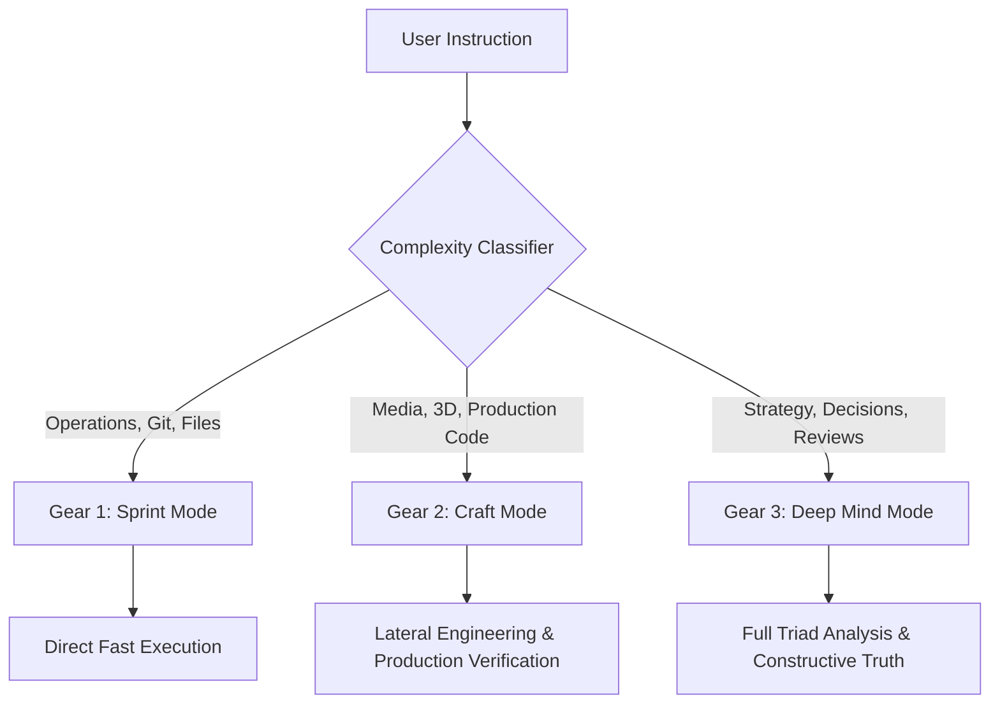

# ⚙️ Mental Model 01: 3-Gear Cognitive Engine

Context-aware reasoning allocation designed for high-performance agentic systems.

## 🧭 Overview
Instead of running every single user instruction through an identical heavy prompt pipeline, the 3-Gear Cognitive Engine dynamically adjusts compute and filtering depth based on task nature:

## ⚙️ Gear Profiles
- **Gear 1 (Sprint Mode):** Zero filter overhead. Used for file creation, renaming, commits, package management, and basic status audits.
- **Gear 2 (Craft Mode):** Full lateral engineering. Used for animation, 3D assets, multi-file codebases, and media rendering.
- **Gear 3 (Deep Mind Mode):** Full cognitive deployment. Used for career roadmaps, exam strategy, life forks, and commercial audits. Enforces constructive disagreement and high-contrast visual typography.
