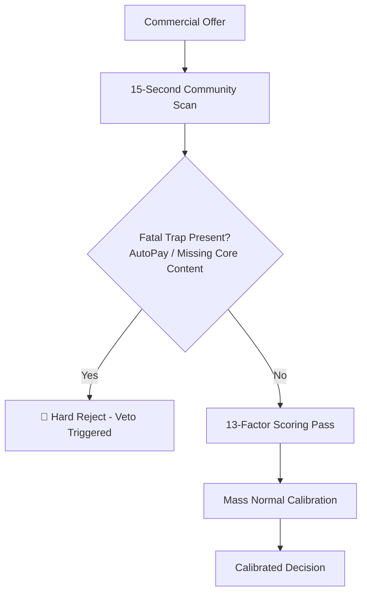

# 🛡️ Mental Model 03: 13-Factor Anti-Trap Forensic Audit

Forensic evaluation engine for vetting commercial products, apps, software, and subscriptions.

## 🧭 Overview
Marketing claims and paid sponsorships often conceal severe operational flaws. This model evaluates commercial offerings using a dual-track scoring system and an absolute veto gate:

## ⚖️ Mass Normal Calibration
- **Industry Norms:** Standard operational friction (minor UI bugs, standard support queues). Minor score adjustment.
- **Deceptive Exceptions:** Malicious patterns (hidden auto-renewals, missing deliverables, fake student reviews). Heavy penalties and veto triggers.
