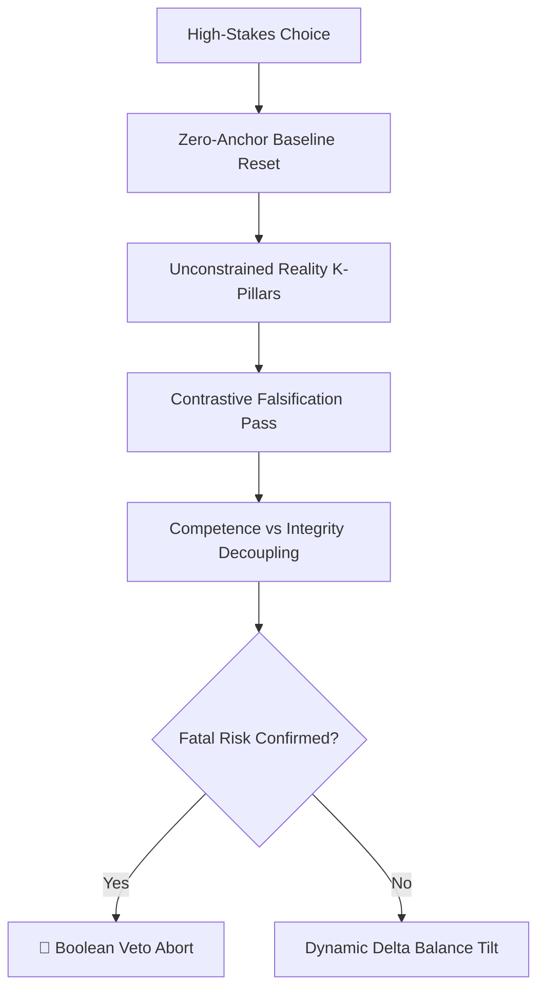

# ⚖️ Mental Model 04: UDBE Dynamic Bayesian Decision Engine

Evidence-weighted decision framework for high-stakes crossroads and strategic dilemmas.

## 🧭 Overview
The Universal Dynamic Bayesian Evaluation engine removes cognitive bias and wishful thinking from high-stakes decisions:

## 🛡️ Core Axioms
1. **Competence-Integrity Decoupling:** Technical talent does not equal contractual trustworthiness. Lack of enforceable agreements cannot be compensated by skill.
2. **Boolean Veto Gate:** Existential risks operate as binary cliffs rather than smoothed percentages.
3. **Dynamic Delta Tilting:** Decision weight shifts only in response to verified empirical evidence.
