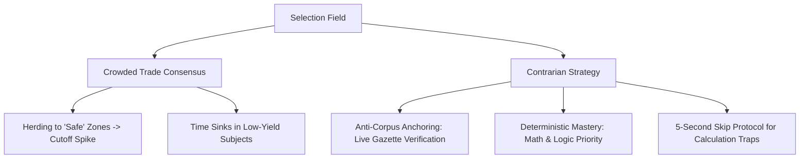

# 📊 Mental Model 05: Contrarian Selection Dynamics & Anti-Corpus Anchoring

Game-theoretic strategy for hyper-competitive examinations and crowded selection funnels.

## 🧭 Overview
When thousands of candidates follow identical coaching advice, the crowded path experiences sharp inflation in competition difficulty:

## 🎯 Strategic Principles
1. **Anti-Corpus Anchoring:** Never rely on obsolete historical cutoffs; verify live active recruitment notifications.
2. **Deterministic Locking:** Maximize time on high-predictability sections (Mathematics and Reasoning) over infinite, low-yield speculative topics.
3. **5-Second Skip Rule:** Instantly bypass time-sink calculation traps on first pass.
