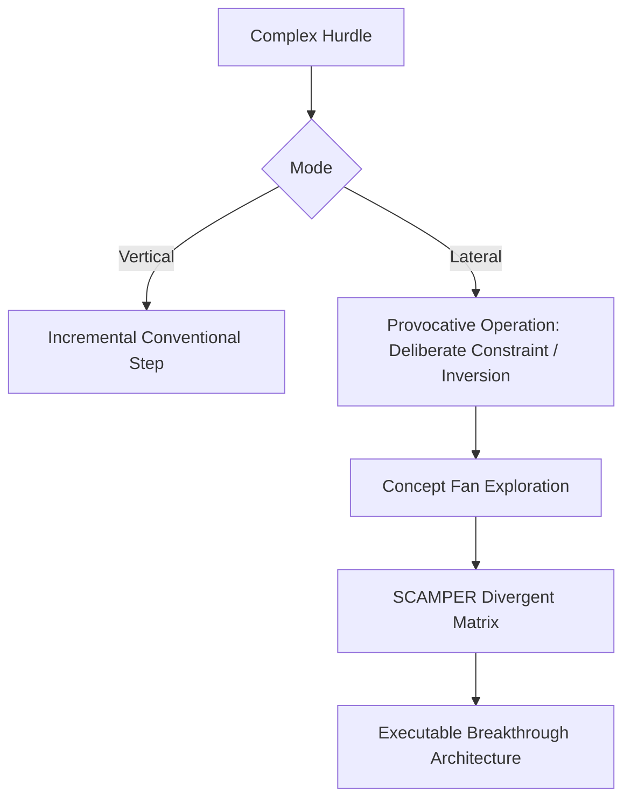

# 💡 Mental Model 07: Lateral Thinking & Creative Provocation

Divergent problem-solving framework to escape linear algorithmic local minima.

## 🧭 Overview
Linear reasoning searches along the most probable path, often landing in conventional dead ends. Lateral thinking deliberately introduces creative provocations to jump into novel solution spaces:

## 🛠️ Key Techniques
- **Provocative Operation (PO):** State an impossible condition to force exploration of novel architectures.
- **Concept Fan:** Step back from specific implementations to identify broader functional directions.
- **Divergence to Convergence:** Ensure imaginative ideas are refined into concrete, testable code and pipelines.
