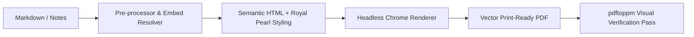

# 🎨 Mental Model 08: Royal Pearl & Deep Teal PDF Design System

Executive document design standards and headless browser publishing architecture.

## 🧭 Overview
Transforms raw markdown into polished, executive-ready A4 PDFs with verified Unicode, Indic font rendering, and visual quality assurance:

## 🎨 Aesthetic Specifications
- **Canvas:** Warm Ivory (`#FAF8F4`) to prevent screen glare and provide reading warmth.
- **Hero Headers:** Deep Midnight Teal (`#0F3D3E`) for visual authority.
- **Accents:** Champagne Gold (`#C59B27`) borders and pill tags.
- **Visual Structure:** Mandatory 3-Card "At a Glance" Executive Summary on Page 1.
- **Verification QA:** Convert PDF pages to PNG and verify layout integrity before distribution.
