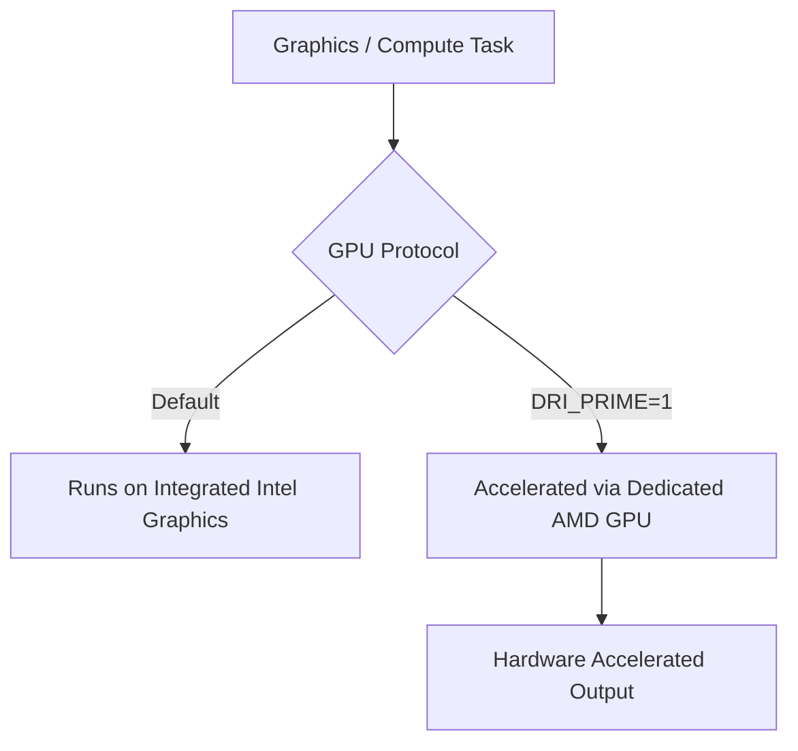

# 🚀 Mental Model 09: Discrete AMD GPU Priority Protocol

Hardware-accelerated rendering and compute routing on Linux hybrid graphics systems.

## 🧭 Overview
Ensures compute-intensive graphics, 3D rendering, video encoding, and headless browser workloads are automatically dispatched to the dedicated discrete AMD GPU rather than the integrated graphics:

## ⚡ Canonical Protocol
- **Shell Commands:** Set `DRI_PRIME=pci-0000_01_00_0` or `DRI_PRIME=1` before graphics processes.
- **Desktop Apps:** Launch via `switcherooctl launch` to ensure correct Wayland/Vulkan handoff.
