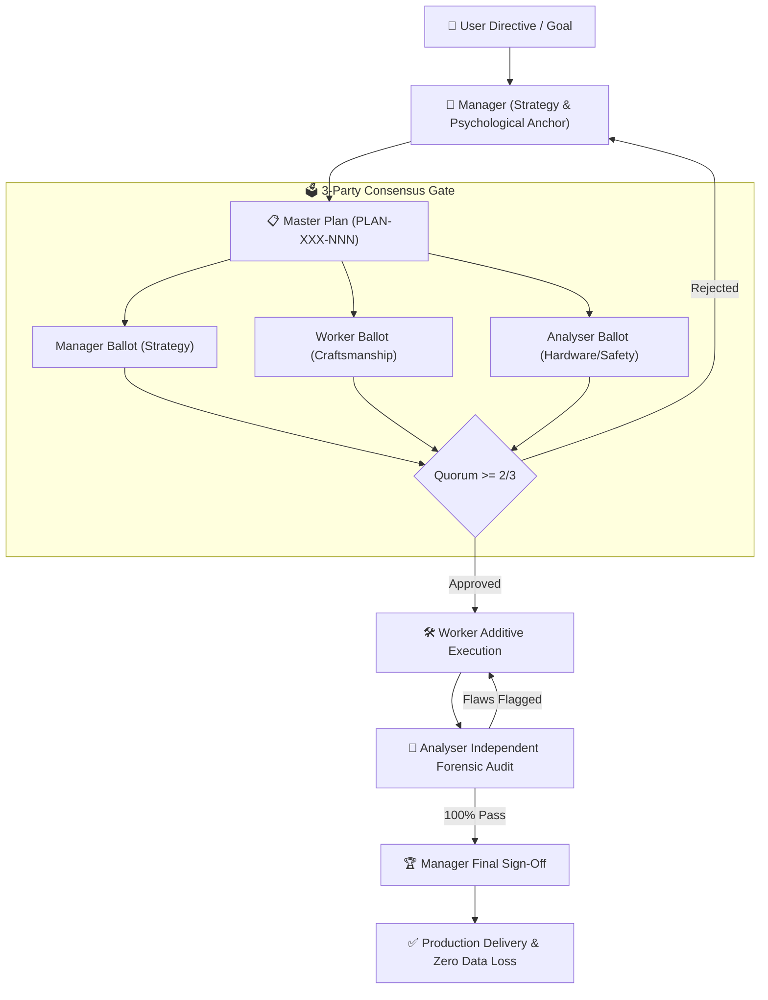

# 🏛️ Mental Model 11: Kanad Monastic Consensus Swarm (KMCS)

Universal tri-party democratic governance, physical hardware-anchored reality, and zero-data-loss execution architecture for autonomous AI agent swarms.

---

## 🧭 1. Executive Summary
The **Kanad Monastic Consensus Swarm (KMCS)** model replaces homogenous or authoritarian multi-agent architectures with an institutional separation of powers, democratic consensus voting (2/3 or 3/3 majority gates), hardware-aware physical fill-rate limits, and monastic execution rigor inspired by the 11th House Saturn in Pisces (মীন রাশিতে একাদশ শনি) mental model.

---

## 🧠 2. Core Pillars of the Mental Model

### 2.1 The "Zero Question Missed" Law (Monastic Rigor)
- **Zero Hallucination / Zero Assumption:** AI agents must never assume success from tool invocation alone. Output files, data payloads, and visual states must be inspected programmatically.
- **Exhaustive Scope Completion:** If an architecture calls for 12 modules, all 12 are built; if a vault has 95 technical notes, all 95 are categorized with zero orphans.

### 2.2 Institutional Separation of Powers
- **Manager:** Strategic direction, human psychology/astrology anchor, master implementation planning. *Prohibited from direct code or note editing.*
- **Worker:** High-aesthetic craftsmanship, additive code and markdown authoring, non-destructive file evolution. *Prohibited from self-approving.*
- **Analyser:** Forensic prosecutor, hardware fill-rate enforcement, cross-vault link verification. *Prohibited from authoring implementations.*

### 2.3 Hardware & Display Server Anchoring
- **GPU Fill-Rate Protection:** Eliminates GPU-crashing effects (e.g., `backdrop-filter: blur()`) on modest hardware (Intel HD 520, 2C/4T CPU, Pop!_OS COSMIC Wayland), guaranteeing smooth 60fps scrolling through solid dark RGBA surfaces and 1px borders.
- **20px Typographic Scaling:** Enforces `overflow-x: auto` containers on KaTeX math blocks and tables to prevent horizontal clipping.

### 2.4 The Zero-Data-Loss Axiom
- Pre-edit line number verification.
- Additive evolution of existing knowledge graphs.
- Automated post-execution audit (0 broken links, 0 orphaned notes).