# 🛡️ Anti-Trap Forensic Review & Scoring Engine

যেকোনো অ্যাপ, কোর্স, সফটওয়্যার বা সার্ভিস কেনার আগে ফাঁদ ও প্রতারণা থেকে রক্ষা করার জন্য একটি গাণিতিক, যাচাইযোগ্য ও বহুমুখী সিদ্ধান্ত-গ্রহণ ফ্রেমওয়ার্ক।

---

## ⚡ ১৫-সেকেন্ড Quick Decision Checklist (তিন ধাপে দ্রুত সিদ্ধান্ত)

যেকোনো নতুন অ্যাপ বা কোর্সের সামনে পড়লে প্রথমে এই ৩টি সহজ ধাপ ফলো করুন:

1. **বিজ্ঞাপনের প্রতি শূন্য বিশ্বাস (Zero Trust on Ads):** ইনফ্লুয়েন্সার বা ফেসবুক অ্যাড যা দাবি করছে, সেটাকে সত্যি নয় বরং **"দাবি"** হিসেবে ধরে নিন।
2. **৩টি জায়গায় চটজলদি সার্চ (Quick Scan):**
   - প্লে স্টোরে **১-স্টার** + **সবচেয়ে সাম্প্রতিক (Most Recent)** রিভিউ।
   - গুগলে: `"[নাম]" site:quora.com review` এবং `site:consumercomplaints.in "[নাম]"`
3. **ফাইনাল ফিল্টার প্রয়োগ:** যদি AutoPay জালিয়াতি, সিলেবাস ফাঁকি, বা স্প্যাম কলের প্রমাণ পান → এক সেকেন্ডও নষ্ট না করে বাতিল।

> পুরো বিশ্লেষণের জন্য নিচের ৫-স্তম্ভ ফ্রেমওয়ার্ক ফলো করুন।

---

## 🧠 মডেলের পেছনের দর্শন (Core Philosophy)

### নীতি ১: Mass Normal Calibration (গণ-স্বাভাবিকতা যাচাই)
- **ফাঁদ = ইন্ডাস্ট্রি নর্ম থাকা নয়, ইন্ডাস্ট্রি নর্মকে ঠকানোর অস্ত্র বানানো।**
- AutoPay, সেলস কল, হিন্দি কনটেন্ট — এগুলো ভারতের EdTech-এ ইন্ডাস্ট্রি নর্ম। এগুলো **আছে** বলেই শাস্তি নয়। কিন্তু যখন এগুলোকে **লুকিয়ে, ঘুরিয়ে বা জোর করে চাপিয়ে** দিয়ে গ্রাহককে ঠকানো হয়, তখনই সেটা **প্রতারণা**।
- প্রতিটি ফ্যাক্টরে তাই দুটো পেনাল্টি সেট: **সেট-ক (নর্মাল)** ও **সেট-খ (প্রতারণা)**।

### নীতি ২: পজিটিভ সমান সমান, নেগেটিভ অসমান (Loss Aversion Asymmetry)
- পজিটিভ দিকে ভারসাম্য (মোট +১০০) কারণ ভালো ফিচারগুলো পরিপূরক।
- নেগেটিভ দিকে ২:১ অসাম্য (মোট -২১২) কারণ একজন পরীক্ষার্থীর কাছে **ক্ষতি সবসময় লাভের চেয়ে বেশি দামি**। ₹৩০০ টাকা গেলে মন খারাপ হয়, কিন্তু ৬ মাসের প্রস্তুতির সময় গেলে জীবন বদলে যায়।

### নীতি ৩: Veto Rule (একটি ভুলেই আউট)
- কোনো একটি ফ্যাক্টরে **সেট-খ -২৫ বা -৩০** পেলে, মোট স্কোর যাই হোক, সরাসরি বাতিল।

---

## 🏛️ ৫টি মূল স্তম্ভ (5 Core Pillars)

### স্তম্ভ ১: বিজ্ঞাপন ও স্পনসরশিপ অডিট (Ad & Sponsorship Deception Gap)
- বিজ্ঞাপন, স্পনসরড ভিডিও ও ল্যান্ডিং পেজের দাবি নোট করুন।
- `Includes Paid Promotion`, ডিসকাউন্ট কোড বা অ্যাফিলিয়েট লিংক দেখলে → মতামত ১০০% বাতিল।
- দাবিগুলোকে পরীক্ষার মাপকাঠি হিসেবে চিহ্নিত করুন (Deception Gap = বিজ্ঞাপনের প্রতিশ্রুতি বনাম আসল প্রোডাক্ট)।

### স্তম্ভ ২: ১০-মুখী মাল্টি-প্ল্যাটফর্ম রাডার (10-Platform Review Radar)
- নিচের ১০টি প্ল্যাটফর্ম থেকে তথ্য সংগ্রহ করুন (বিস্তারিত সার্চ কোয়েরি নিচে)।

### স্তম্ভ ৩: রিভিউ ব্যবচ্ছেদ ও সব ধরণের ফাঁদ (Review Motives & All-Trap Taxonomy)
- ১-স্টার, ২-৩ স্টার ও ৫-স্টার রিভিউ আলাদাভাবে বিশ্লেষণ।
- ৬ ধরণের ফাঁদ সনাক্ত করুন (বিস্তারিত নিচে)।

### স্তম্ভ ৪: সময়ের গতিবিধি ও ট্রেন্ড অডিট (Time-Decay: শেষ ৩০-৯০ দিন)
- Most Recent কমেন্ট ফিল্টার করে দেখুন প্রোডাক্ট উন্নত হচ্ছে নাকি নষ্ট হচ্ছে।

### স্তম্ভ ৫: ডেভেলপার আচরণ ও সাপোর্ট অডিট (Post-Sales Support Character)
- নেগেটিভ কমেন্টে ডেভেলপারের জবাব কি কপি-পেস্ট রোবটিক বয়লারপ্লেট, নাকি সরাসরি সমাধান?

---

## 🕳️ ৬ ধরণের ফাঁদ (The 6 Trap Dimensions)

| ফাঁদের ধরন | রিভিউতে কীভাবে ধরা পড়ে? (লক্ষণ) |
| :--- | :--- |
| **১. আর্থিক ফাঁদ (Financial Trap)** | "AutoPay বন্ধ করার অপশন নেই", "না জানিয়ে টাকা কেটে নিচ্ছে", "রিফান্ড দেয় না" |
| **২. সিলেবাস ও কনটেন্ট ফাঁদ (Content Void Trap)** | "অনেক চ্যাপ্টার ফাঁকা", "মডার্ন হিস্ট্রি আছে কিন্তু এন্সিয়েন্ট গায়েব", "পুরনো সিলেবাস" |
| **৩. ভাষা বদলের ফাঁদ (Language Bait-and-Switch)** | "ইংরেজি বলে ভেতরে হিন্দি", "গুগল ট্রান্সলেটের আবর্জনা", "অডিও-সাবটাইটেল মিসম্যাচ" |
| **৪. ডিভাইস ও টেকনিক্যাল ফাঁদ (Device Lockout Trap)** | "ল্যাপটপে চলে না", "স্ক্রিন অফে অডিও বন্ধ", "ফোন হ্যাং করে" |
| **৫. প্রাইভেসি ও স্প্যাম ফাঁদ (Data Harvesting Trap)** | "দিনে ৫-১০ বার সেলস কল", "নম্বর ব্লক করার উপায় নেই", "হোয়াটসঅ্যাপে স্প্যাম" |
| **৬. মেকি আত্মবিশ্বাসের ফাঁদ (Illusion of Competence Trap)** | "কুইজে ৯০% পেলাম কিন্তু পরীক্ষায় কিছুই মিলেনি", "বাচ্চাদের মতো সহজ প্রশ্ন" |

---

## 🌐 ১০টি প্ল্যাটফর্মের সার্চ কোয়েরি টেমপ্লেট

প্রতিটি প্ল্যাটফর্মে `[BRAND]` এর জায়গায় প্রোডাক্ট/কোম্পানির নাম বসান:

| ক্র. | প্ল্যাটফর্ম | সার্চ কোয়েরি / কীভাবে খুঁজবেন |
| :---: | :--- | :--- |
| **১** | **Google Play / App Store** | অ্যাপ পেজে গিয়ে ফিল্টার: **'Critical' (১★ ও ২★)** এবং **'Most Recent'** সিলেক্ট করুন |
| **২** | **Quora** | গুগলে: `site:quora.com "[BRAND]" review OR reality OR scam` |
| **৩** | **MouthShut.com** | গুগলে: `site:mouthshut.com "[BRAND]"` অথবা সরাসরি সাইটে সার্চ করুন |
| **৪** | **Google Reviews & Search** | গুগলে: `"[BRAND]" reviews` → ডানপাশে Knowledge Panel / Google Business Profile দেখুন |
| **৫** | **ConsumerComplaints.in & NCH** | গুগলে: `site:consumercomplaints.in "[BRAND]"` |
| **৬** | **Reddit** | গুগলে: `site:reddit.com "[BRAND]" review OR scam OR experience` (সাবরেডিট: `r/UPSC`, `r/SSCCGL`, `r/Indian_Academia`, `r/kolkata`) |
| **৭** | **Twitter / X** | X সার্চবারে: `@[BRAND_HANDLE] refund OR scam OR fraud OR worst` |
| **৮** | **PagalGuy & DesiDime** | গুগলে: `site:pagalguy.com "[BRAND]"` বা `site:desidime.com "[BRAND]" subscription OR hidden charge` |
| **৯** | **কোম্পানির নিজস্ব ওয়েবসাইট** | টেস্টিমোনিয়াল সেকশনে: ছবি **Google Lens** দিয়ে রিভার্স সার্চ (স্টক ছবি কি না), সব ৫★ দেখলে সন্দেহ, বয়ান কি তোতাপাখি স্ক্রিপ্ট, টপার কি অন্য ৫টি কোচিংয়েরও ফুল-টাইম স্টুডেন্ট |
| **১০** | **টেলিগ্রাম স্টুডেন্ট গ্রুপস** | গ্রুপের সার্চবারে `[BRAND]` লিখে কাঁচা, আনফিল্টার্ড চ্যাট দেখুন |

---

## 📊 ১৩-ফ্যাক্টর Dual-Set স্কোরিং মডেল

বিস্তারিত মার্কিং টেবিল, প্রতিটি ফ্যাক্টরের বাস্তব উদাহরণ এবং কাট-অফ → [scoring-model.md](./references/scoring-model.md)

### সংক্ষিপ্ত টেবিল:

| ক্র. | ফ্যাক্টর | ✅ (+) | 🔵 সেট-ক (-) | 🔴 সেট-খ (-) |
| :---: | :--- | :---: | :---: | :---: |
| ১ | সিলেবাস ও কনটেন্ট সম্পূর্ণতা | +১২ | -৫ | -২৫ |
| ২ | পড়াশোনার আসল গভীরতা (Exam Rigor) | +১২ | -৫ | -২২ |
| ৩ | আর্থিক নিরাপত্তা (AutoPay স্বচ্ছতা) | +১০ | -৫ | -৩০ |
| ৪ | স্বাধীন ফোরাম জনমত (Quora/Reddit/MouthShut) | +১০ | -৫ | -২০ |
| ৫ | যাচাইকৃত ৫★ রিভিউ সততা | +১০ | -৩ | -১৫ |
| ৬ | ২-৩ স্টার গ্রাউন্ড রিয়ালিটি | +৮ | -৩ | -৭ |
| ৭ | সাম্প্রতিক ৩০-৯০ দিন ট্রেন্ড | +৮ | -৩ | -১৫ |
| ৮ | ভাষাগত স্বচ্ছতা | +৮ | -৩ | -২০ |
| ৯ | বিজ্ঞাপনের সততা | +৬ | -৩ | -১৫ |
| ১০ | টেকনিক্যাল স্থায়িত্ব ও ডিভাইস এক্সেস | +৩ | -২ | -১০ |
| ১১ | প্রাইভেসি ও স্প্যাম কল প্রতিরোধ | +৫ | -৩ | -১৫ |
| ১২ | ডেভেলপার সাপোর্ট ও কাস্টমার আচরণ | +৪ | -২ | -১০ |
| ১৩ | ওয়েবসাইট রিভিউ ও টেস্টিমোনিয়াল সততা | +৪ | -২ | -৮ |
| | **মোট** | **+১০০** | **-৪৪** | **-২১২** |

### নেট স্কোর সূত্র:
```
Net Score = মোট পজিটিভ পয়েন্ট - মোট নেগেটিভ পেনাল্টি (সেট-ক বা সেট-খ, যেটি প্রযোজ্য)
```

---

## 🎯 কাট-অফ ও সিদ্ধান্ত

| নেট স্কোর | সিদ্ধান্ত | করণীয় |
| :---: | :--- | :--- |
| **+৬৫ বা বেশি** | 🟢 **সবুজ (Full Pass)** | নিরাপদ — পুরোপুরি ব্যবহার করুন |
| **+৩৫ থেকে +৬৪** | 🟡 **হলুদ (Conditional Use)** | Conditional Sandbox Protocol ফলো করুন (নিচে) |
| **+৩৫-এর নিচে** | 🛑 **লাল (Hard Reject)** | আনইনস্টল ও ব্ল্যাকলিস্ট |
| **যেকোনো ১টিতে -২৫ বা -৩০** | 🚨 **ভিটো (Instant Kill)** | মোট স্কোর যাই হোক, সরাসরি বাতিল |

---

## 🟡 Conditional Sandbox Protocol (হলুদ সিদ্ধান্তে সুরক্ষা ব্যবস্থা)

যদি প্রোডাক্টের কনটেন্ট ভালো কিন্তু কিছু ঝুঁকি থাকে (হলুদ জোন), তবে নিচের সুরক্ষা ব্যবস্থা নিয়ে ব্যবহার করুন:

1. **ফেক মোবাইল নম্বর:** প্রাথমিক নম্বর দেবেন না। সেকেন্ডারি বা ভার্চুয়াল নম্বর ব্যবহার করুন (যেমন: Google Voice, TextNow)।
2. **নো-অটোপে ভার্চুয়াল কার্ড:** UPI AutoPay চালু করবেন না। পেমেন্ট করতে হলে ওয়ান-টাইম ভার্চুয়াল কার্ড (যেমন: FamPay, Slice-এর disposable card) বা UPI Lite ব্যবহার করুন।
3. **ফেক ইমেইল:** প্রাথমিক Gmail/Outlook দেবেন না। একটি আলাদা throwaway ইমেইল ব্যবহার করুন।
4. **ট্রায়াল ক্যালেন্ডার রিমাইন্ডার:** ফ্রি ট্রায়াল শুরু করলে ক্যালেন্ডারে শেষ হওয়ার ২ দিন আগে রিমাইন্ডার সেট করুন।
5. **পারমিশন অডিট:** অ্যাপ ইনস্টলের পর Settings > Apps > Permissions থেকে অপ্রয়োজনীয় পারমিশন (Contacts, Location, Camera) বন্ধ করুন।

---

## 🗺️ সম্পূর্ণ সমন্বিত মাইন্ডম্যাপ (Integrated Master Mind Map)

```mermaid
flowchart TD
    classDef rootNode fill:#0F3D3E,stroke:#C59B27,stroke-width:3px,color:#FFFFFF;
    classDef pillarNode fill:#1E293B,stroke:#38BDF8,stroke-width:2px,color:#FFFFFF;
    classDef subNode fill:#FAF8F4,stroke:#0F3D3E,stroke-width:1px,color:#222831;
    classDef trapNode fill:#FBECE9,stroke:#B84A39,stroke-width:1.5px,color:#222831;
    classDef engineNode fill:#0F3D3E,stroke:#C59B27,stroke-width:3px,color:#FFFFFF;
    classDef rejectNode fill:#B84A39,stroke:#FFFFFF,stroke-width:2px,color:#FFFFFF;
    classDef condNode fill:#D4AF37,stroke:#222831,stroke-width:2px,color:#222831;
    classDef passNode fill:#2E6F5E,stroke:#FFFFFF,stroke-width:2px,color:#FFFFFF;

    ROOT["প্রোডাক্ট / অ্যাপ / কোর্স অডিট ও যাচাই মাস্টার ফ্রেমওয়ার্ক"]:::rootNode

    ROOT --> P1["স্তম্ভ ১: বিজ্ঞাপন ও স্পনসরশিপের ফারাক"]:::pillarNode
    ROOT --> P2["স্তম্ভ ২: ১০-মুখী মাল্টি-প্ল্যাটফর্ম রাডার"]:::pillarNode
    ROOT --> P3["স্তম্ভ ৩: রিভিউ ব্যবচ্ছেদ ও সব ধরণের ফাঁদ"]:::pillarNode
    ROOT --> P4["স্তম্ভ ৪: সময়ের গতিবিধি ও ট্রেন্ড অডিট"]:::pillarNode
    ROOT --> P5["স্তম্ভ ৫: ডেভেলপার আচরণ ও সাপোর্ট অডিট"]:::pillarNode

    P1 --> P1_SCAN["বিজ্ঞাপনের দাবি ও স্পনসর মার্কার স্ক্যান"]:::subNode
    P1_SCAN -->|পেইড প্রমোশন / অ্যাফিলিয়েট| P1_DISCARD["মতামত ১০০% বাতিল"]:::subNode
    P1_SCAN -->|চটকদার প্রতিশ্রুতি| P1_CLAIM["দাবিগুলো পরীক্ষার মাপকাঠি"]:::subNode
    P1_CLAIM --> P1_COMPARE["Deception Gap: দাবি বনাম বাস্তব"]:::subNode
    P1_COMPARE -->|দাবি মিথ্যা| SIG_DECEPTIVE["ইচ্ছাকৃত প্রতারণার সিগন্যাল"]:::trapNode
    P1_COMPARE -->|দাবি ও বাস্তব মিল| SIG_HONEST["সৎ বিপণন সিগন্যাল"]:::subNode

    P2 --> S_STORE["১. Google Play ও App Store"]:::subNode
    P2 --> S_QUORA["২. Quora"]:::subNode
    P2 --> S_MOUTH["৩. MouthShut.com"]:::subNode
    P2 --> S_GOOGLE["৪. Google Reviews ও Search"]:::subNode
    P2 --> S_CONSUMER["৫. ConsumerComplaints.in ও NCH"]:::subNode
    P2 --> S_REDDIT["৬. Reddit"]:::subNode
    P2 --> S_TWITTER["৭. Twitter / X"]:::subNode
    P2 --> S_FORUM["৮. PagalGuy ও DesiDime"]:::subNode
    P2 --> S_ONSITE["৯. কোম্পানির নিজস্ব ওয়েবসাইট"]:::subNode
    P2 --> S_TELEGRAM["১০. টেলিগ্রাম স্টুডেন্ট গ্রুপস"]:::subNode

    P3 --> R_1["১-স্টার রিভিউ অডিট"]:::pillarNode
    P3 --> R_MID["২-৩ স্টার রিভিউ অডিট"]:::pillarNode
    P3 --> R_5["৫-স্টার রিভিউ অডিট"]:::pillarNode

    R_1 -->|ব্যক্তিগত রাগ| R1_NOISE["ব্যক্তিগত নালিশ বাতিল"]:::subNode
    R_1 -->|সিস্টেমিক ফাঁদ| R1_TRAPS["সব ধরণের ফাঁদের এক্স-রে"]:::trapNode

    R1_TRAPS --> TRAP_FIN["১. আর্থিক ফাঁদ"]:::trapNode
    R1_TRAPS --> TRAP_CONT["২. সিলেবাস ফাঁদ"]:::trapNode
    R1_TRAPS --> TRAP_LANG["৩. ভাষা বদলের ফাঁদ"]:::trapNode
    R1_TRAPS --> TRAP_TECH["৪. ডিভাইস ফাঁদ"]:::trapNode
    R1_TRAPS --> TRAP_SPAM["৫. স্প্যাম ফাঁদ"]:::trapNode
    R1_TRAPS --> TRAP_PED["৬. মেকি আত্মবিশ্বাসের ফাঁদ"]:::trapNode

    R_MID --> SIG_REAL["আসল গ্রাউন্ড রিয়ালিটি"]:::subNode
    R_5 -->|ফেক বট| R5_FAKE["ফেক রিভিউ বাতিল"]:::subNode
    R_5 -->|আসল স্ক্রিনশট| SIG_POS["খাঁটি পজিটিভ সিগন্যাল"]:::subNode

    P4 --> T_REC["গত ৩০-৯০ দিনের কমেন্ট ফিল্টার"]:::subNode
    T_REC -->|বাগ ফিক্স ও আপডেট| SIG_UP["কোয়ালিটি আপগ্রেড"]:::subNode
    T_REC -->|ক্র্যাশ ও পরিত্যক্ত| SIG_DOWN["কোয়ালিটি ডাউনগ্রেড"]:::trapNode

    P5 --> D_RESP["নেগেটিভ কমেন্টে ডেভেলপারের জবাব"]:::subNode
    D_RESP -->|রোবটিক বয়লারপ্লেট| SIG_DEV_BAD["দায়িত্বহীন সাপোর্ট"]:::trapNode
    D_RESP -->|সরাসরি সমাধান| SIG_DEV_GOOD["দায়িত্বশীল সাপোর্ট"]:::subNode

    S_STORE & S_QUORA & S_MOUTH & S_GOOGLE & S_CONSUMER & S_REDDIT & S_TWITTER & S_FORUM & S_ONSITE & S_TELEGRAM -.-> P3
    S_STORE & S_REDDIT & S_TWITTER -.-> P4
    S_STORE & S_TWITTER & S_CONSUMER -.-> P5

    SIG_DECEPTIVE --> ENGINE{"কেন্দ্রীয় সংশ্লেষণ ও সিদ্ধান্ত ইঞ্জিন"}:::engineNode
    SIG_HONEST --> ENGINE
    TRAP_FIN & TRAP_CONT & TRAP_LANG & TRAP_TECH & TRAP_SPAM & TRAP_PED --> ENGINE
    SIG_REAL --> ENGINE
    SIG_POS --> ENGINE
    SIG_UP --> ENGINE
    SIG_DOWN --> ENGINE
    SIG_DEV_BAD --> ENGINE
    SIG_DEV_GOOD --> ENGINE

    ENGINE -->|মারাত্মক ফাঁদ ও প্রতারণা প্রমাণিত| OUT_REJECT["HARD REJECT: সম্পূর্ণ বাতিল"]:::rejectNode
    ENGINE -->|কনটেন্ট ভালো কিন্তু ঝুঁকি আছে| OUT_COND["CONDITIONAL USE: Sandbox Protocol দিয়ে ব্যবহার"]:::condNode
    ENGINE -->|সৎ বিজ্ঞাপন ও আসল প্রমাণ ও সুনাম| OUT_PASS["FULL PASS: নিরাপদ ও লাভজনক"]:::passNode
```



---

## 🔗 বিস্তারিত রেফারেন্স ও টুলস

- **১৩-ফ্যাক্টরের পূর্ণ বিবরণ, বাস্তব উদাহরণ ও কাট-অফ:** [scoring-model.md](./references/scoring-model.md)
- **অটোমেটেড ক্যালকুলেটর CLI স্ক্রিপ্ট:** [anti_trap_calc.py](./scripts/anti_trap_calc.py)
  - ডেমো দেখতে রান করুন: `python3 ~/.gemini/config/skills/anti-trap-review/scripts/anti_trap_calc.py --demo`
  - কোনো অ্যাপের মূল্যায়ন করতে: `python3 ~/.gemini/config/skills/anti-trap-review/scripts/anti_trap_calc.py --json <path_to_eval.json>`

