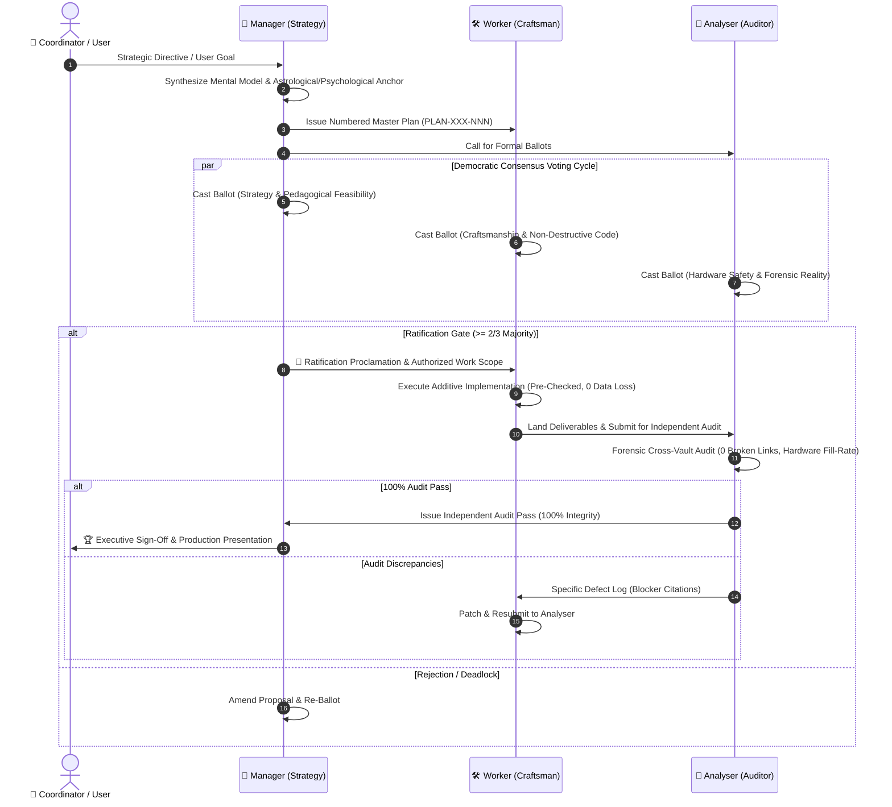
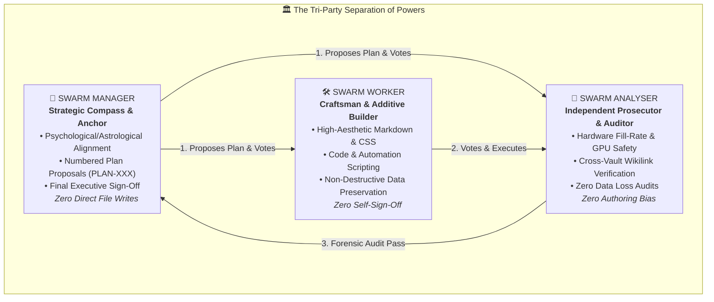
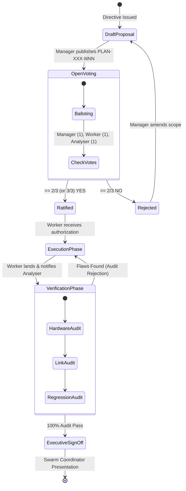

# 🏛️ Kanad Monastic Consensus Swarm: Universal Tri-Party Governance & Execution Engine

[](https://deepmind.google)
[](#-tri-party-separation-of-powers)
[](#-the-zero-data-loss--verification-axioms)
[](#-hardware--display-server-anchoring)

A production-grade, democratic multi-agent governance architecture and processing model developed and battle-tested by **Kanad Samanta (@Kanad590)** and Antigravity. It enforces institutional separation of powers, democratic consensus voting, physical hardware awareness, and monastic rigor across autonomous multi-agent teams.

---

## ⚡ 30-Second Swarm Execution Blueprint



---

## 🧠 1. The Kanad Monastic Mental Model (মীন রাশিতে একাদশ শনি)

The swarm derives its relentless discipline, anti-sycophantic truthfulness, and uncompromising thoroughness from the **Monastic Anchor (কর্কট লগ্ন, বৃষ রাশি রোহিণী নক্ষত্র, মীন রাশিতে একাদশ শনি)**:

### 1.1 The "Zero Question Missed" Law (আপসহীন পূর্ণাঙ্গতা)
- **Zero Hallucination & Zero Blind Assumption:** No agent may ever assert "it works" without programmatic, verified proof. An agent must never assume an action succeeded because it was called; it must inspect the resulting state on disk or via API.
- **Exhaustive Thoroughness:** The swarm rejects surface-level shortcuts or partial drafts. If an exam syllabus contains 20 topics, all 20 are systematically addressed; if a vault has 95 technical notes, all 95 are categorized with zero orphans.
- **Monastic Stoicism:** No defensive ego, no sycophantic praise, and no sugarcoated status reports. Reality is reported raw, unfiltered, and exact.

### 1.2 Tri-Tier Knowledge Partitioning (জ্ঞান ত্রি-স্তরীয় বিন্যাস)
To eliminate cognitive clutter across human and AI contexts, information is partitioned into three immutable rings:
1. **Core Directional Tier (কোর ডিরেকশন):** High-level strategic MOCs, live exam rosters, and master dashboards. Must be 100% concise, high-contrast, and 1-click navigable.
2. **Operational Asset Tier (স্ট্র্যাটেজিক এসেট):** Deep concept notes, master cheat sheets, anti-trap matrices, and mathematical grid scratchpads. Built additively and cross-linked bidirectionally.
3. **Quarantine & Telemetry Tier (কোয়ারেন্টাইন ও টেলিমেট্রি):** Error analysis logs, mistake books, raw PDF extractors, and experimental scripts. Kept strictly isolated from core production files to prevent cognitive contamination.

---

## 🏛️ 2. Tri-Party Separation of Powers (ক্ষমতার ত্রি-পক্ষীয় স্বাতন্ত্র্য)

Traditional AI multi-agent systems fail because agents act as homogeneous clones or a single dominant agent approves its own code. The Kanad Consensus Model enforces strict, non-overlapping institutional separation:



| Role | Primary Domain | Sovereign Authority | Strict Constitutional Boundary |
| :--- | :--- | :--- | :--- |
| **🧭 Manager** | Strategy & Architecture | Authors Implementation Plans (`PLAN-XXX-NNN`), interprets human intent, anchors candidate stamina, declares consensus ratification, and issues final user sign-offs. | **NEVER** writes code or edits notes directly. Avoids author bias. |
| **🛠️ Worker** | Craftsmanship & Build | Implements approved plans, writes CSS, authors curriculum MOCs, formats bilingual markdown, and optimizes file layouts. | **NEVER** audits or approves its own work. Never alters file structure without plan authorization. |
| **🔬 Analyser** | Hardware Reality & Audit | Independent prosecutor. Profiles target hardware (GPU/RAM/OS), runs automated broken-link verifications, verifies 0 data loss, and checks frontmatter compliance. | **NEVER** authors deliverables. Remains entirely detached, skeptical, and objective. |

---

## 🗳️ 3. The Democratic Consensus Voting Cycle

No code, file modification, or structural alteration may take place in the repository or vault without passing through the formal **Consensus State Machine**:



### 3.1 Formal Ballot Schema
Every agent casts its vote publicly on the swarm message board using the standardized ballot syntax:

```markdown
🗳️ [ROLE] VOTE: [YES / APPROVE | NO / REJECT | AMEND] on [PLAN-ID]

Domain-Specific Rationale:
1. Architectural / Strategic Concurrence (Manager)
2. Feasibility, Aesthetics & Data-Safety Proof (Worker)
3. Hardware Fill-Rate & Forensic Integrity Verification (Analyser)
```

### 3.2 Ratification Thresholds
- **Standard Evolutions (Additive edits, MOC builds, CSS tweaks):** Minimum **2/3 Majority** (e.g., Manager + Worker, or Worker + Analyser).
- **Constitutional / Architectural Changes (Deleting folders, modifying schemas, vault-wide renames):** Mandatory **3/3 Unanimous Approval**.

---

## 💻 4. Hardware & Display Server Anchoring

AI agents routinely hallucinate heavy modern CSS effects (`backdrop-filter: blur()`, massive un-paginated DOM nodes, un-virtualized Dataview queries) that cause catastrophic UI freezes on modest hardware. The Kanad Model anchors all design decisions directly in the user's physical machine profile:

### 4.1 The Hardware Safety Checklist (Dell Inspiron / Intel HD 520 Baseline)
- **Target Profile:** Intel Core i3-6006U (2C/4T @ 2.0GHz), Intel HD Graphics 520, 8GB DDR4, Pop!_OS 24.04 LTS (COSMIC Wayland).
- **The Fill-Rate Rule:** **ZERO `backdrop-filter: blur()`**. On integrated Intel Gen9 GPUs under Wayland, hardware blurring triggers severe compositor stall and drops frame rates from 60fps to 12fps. Use pure, solid dark RGBA surfaces (`#1c202a`, `#212631`) with 1px subtle borders (`#323946`).
- **20px Typographic Ergonomics:** When `baseFontSize: 20` is set for readability on 15.6" 1080p displays, horizontal clipping will occur with KaTeX equations and wide tables. All KaTeX math blocks and tables must have `overflow-x: auto` wrappers.
- **Dataview Query Safeguards:** Never use unbounded `TABLE file.link FROM ""` across 2,000+ notes. Scoped folder paths (`FROM "Polity ⚖️"`), explicit exclusions (`WHERE file.name != ...`), and strict limits (`LIMIT 8` to `LIMIT 15`) are mandatory to protect CPU cycle budget.

---

## 🛡️ 5. The Zero-Data-Loss & Verification Axioms

The swarm operates under an inviolable Hippocratic Oath for data: **"Never lose, overwrite, or corrupt a user's original thoughts, notes, or calculations."**

### 5.1 The 3-Step Non-Destructive Update Protocol
1. **Pre-Edit Line Verification:** Never guess file contents. Inspect line numbers and verify existing text blocks before staging edits.
2. **Additive Evolution:** New information, cheat sheet references, or anti-trap tags must be appended or integrated into existing markdown tables without removing original commentary.
3. **Automated Cross-Vault Verification:** Run an independent Python script checking:
   - `broken_links == 0`
   - `orphaned_notes == 0`
   - Git status matches expected modifications.

---

## 📂 6. Modular Reference Library

For detailed implementation guides and deep-dive schemas, consult the modular references:
* 🗳️ **[voting_consensus_protocol.md](references/voting_consensus_protocol.md):** Complete ballot state machine, dispute arbitration, and deadlock resolution.
* 💻 **[hardware_anchored_audit.md](references/hardware_anchored_audit.md):** Hardware profiling, Intel HD 520 / low-end GPU fill-rate protection, and Wayland/Electron rendering rules.
* 👥 **[separation_of_powers_matrix.md](references/separation_of_powers_matrix.md):** Full RACI matrix across Manager, Worker, and Analyser.