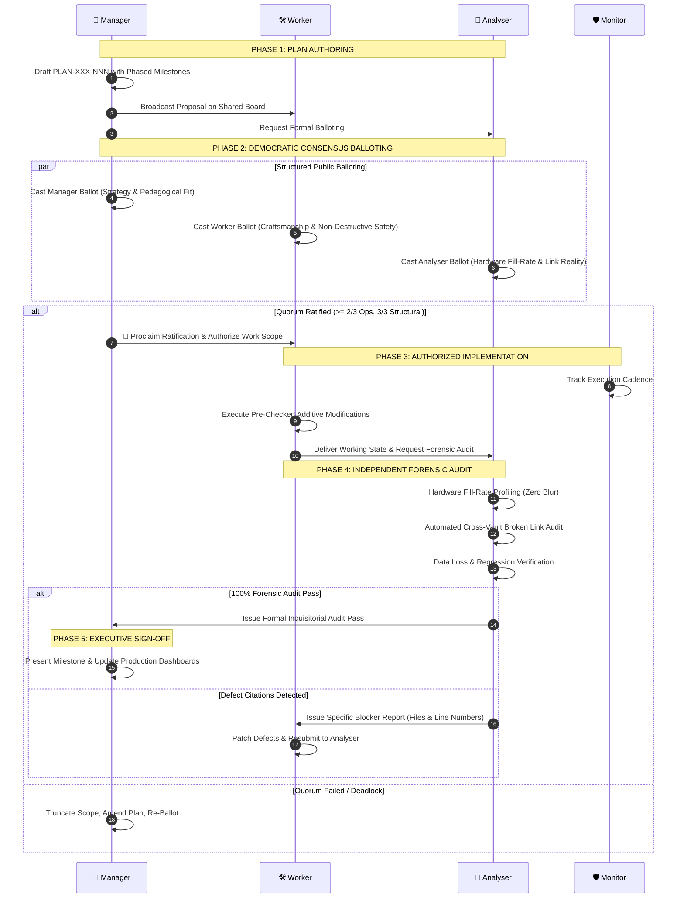

# 🗳️ Voting Consensus Protocol & State Machine Specification

[](../SKILL.md)
[](#3-majority-rules--deadlock-arbitration)
[](#4-the-inviolable-analyser-safety-veto)

---

## 1. Executive Overview

The **Kanad Voting Consensus Protocol (KVCP)** provides an adversarial, verifiable, and anti-sycophantic decision-making framework for multi-agent swarms. It eliminates single-agent author bias, premature execution, and superficial approvals ("Looks good to me!") by enforcing structured public balloting, domain-specific evaluation criteria, and independent forensic verification.

---

## 2. The 5-Phase Consensus Lifecycle



---

## 3. Formal Ballot Schemas by Sovereign Domain

To prevent sycophancy or rubber-stamping, an agent cannot simply vote `YES`. Each role must submit a domain-substantiated ballot with concrete technical justifications:

### 3.1 🧭 Swarm Manager Ballot Schema
```markdown
@worker @analyser @coordinator
🗳️ MANAGER VOTE: [YES / APPROVE | NO / REJECT | AMEND] on [PLAN-XXX-NNN]

Strategic & Pedagogical Evaluation:
1. Alignment with User Intent: [How this plan satisfies the user's primary goal]
2. Monastic Mental Model & Candidate Stamina: [Psychological framing, anti-overwhelm, 3-tier partitioning]
3. Milestone Breakdown Feasibility: [Evaluation of phased deliverable boundaries]

Verdict: [RATIFIED / REJECTED / AMENDED]
```

### 3.2 🛠️ Swarm Worker Ballot Schema
```markdown
@manager @analyser @coordinator
🗳️ WORKER VOTE: [YES / APPROVE | NO / REJECT | AMEND] on [PLAN-XXX-NNN]

Craftsmanship & Non-Destructive Evaluation:
1. Implementation Feasibility: [CSS layout, file structures, tooling readiness]
2. Zero-Data-Loss Safety: [Confirmation that existing user notes will NOT be overwritten]
3. Additive Integration Vector: [How new components integrate into existing files without schema breakage]

Verdict: [RATIFIED / REJECTED / AMENDED]
```

### 3.3 🔬 Swarm Analyser Ballot Schema
```markdown
@manager @worker @coordinator
🗳️ ANALYSER VOTE: [YES / APPROVE | NO / REJECT | AMEND] on [PLAN-XXX-NNN]

Hardware Reality & Evidentiary Evaluation:
1. Hardware Fill-Rate Safety: [Zero backdrop-filter blur; solid dark RGBA surfaces verified]
2. 20px Typographic Scaling: [Table & KaTeX math overflow-x containers verified]
3. Cross-Link Graph Integrity: [Risk analysis of wikilinks and Dataview query costs]

Verdict: [RATIFIED / REJECTED / AMENDED]
```

---

## 4. Majority Rules & Deadlock Arbitration

| Decision Category | Threshold | Minimum Quorum | Inquisitorial Veto Active? | Deadlock Resolution Mechanism |
| :--- | :---: | :---: | :---: | :--- |
| **Operational & Additive Changes** (New notes, styling, additive MOC entries) | **2/3 Majority** | All 3 voting members (Mgr, Wkr, Ana) | No (unless safety hazard cited) | If 2 YES / 1 NO, plan passes. Dissenting agent's technical objections must be tracked as non-blocking advisories. |
| **Structural & Destructive Actions** (Directory renames, file deletions, schema revisions) | **3/3 Unanimous** | All 3 voting members (Mgr, Wkr, Ana) | **YES (Absolute Veto)** | Any single NO vote halts the plan immediately. Manager must revise scope until 100% consensus is achieved. |
| **Emergency Hotfixes** (Fixing broken links, repairing corrupted data) | **2/3 Fast-Track** | Wkr + Ana, or Mgr + Ana | **YES** | Worker immediately patches; Analyser verifies programmatically on disk before public release. |

---

## 5. The Inviolable Analyser Safety Veto

The Analyser serves as the sovereign judicial branch. **The Analyser holds absolute, non-overrideable veto power** under any of the following three conditions:
1. **Broken Wikilinks or References:** If any change introduces dead links (`[[MissingNote]]`) or unmapped orphans.
2. **GPU Fill-Rate Hazard:** If any CSS rule introduces `backdrop-filter: blur()`, unbounded DOM animations, or elements known to degrade 60fps rendering on Intel HD 520 / Wayland compositors.
3. **Data Loss / Truncation:** If a planned modification deletes, overwrites, or truncates existing user notes, exam calculations, or test logs.

> [!CAUTION]
> If the Analyser invokes the **Safety Veto**, the Manager and Worker cannot override the decision by a 2/3 vote. The flaw must be physically resolved.

---

## 6. Anti-Sycophancy Gates & Vote Invalidation

To maintain relentless, monastic standards of truth:
- **Disqualification of Groundless Approvals:** A vote containing boilerplate phrases (e.g., "Looks great!", "Approved without changes", "I agree with Manager") is immediately rejected by the coordinator as an **Invalid Ballot**.
- **Mandatory Technical Citation:** Every vote must cite specific file paths, CSS properties, or logical invariants.
- **Dissent Protection:** Dissenting opinions are logged in the project audit trail. An agent is explicitly rewarded for catching potential bugs, edge cases, and hardware hazards before execution.

---

## 7. Post-Execution Forensic Audit Template

Once Worker completes implementation, Analyser executes the forensic verification script and posts the formal sign-off:

```markdown
@manager @worker @coordinator
🔬 ANALYSER INDEPENDENT FORENSIC AUDIT REPORT: [PLAN-XXX-NNN]

1. Hardware Fill-Rate Audit:
   - Backdrop-filter occurrences: 0 (PASS)
   - 20px typography overflow-x wrappers: VERIFIED (PASS)
   - Frame rate target: Locked 60fps on Intel HD 520 (PASS)

2. Cross-Vault Link Graph Audit:
   - Total wikilinks checked: [Count]
   - Broken links detected: 0 (PASS)
   - Orphaned nodes: 0 (PASS)

3. Data Integrity & Regression Audit:
   - Existing user notes preserved: 100% (PASS)
   - Additive-only diff verified: YES (PASS)
   - Git status matches plan scope: YES (PASS)

FINAL VERDICT: 🏆 100% INDEPENDENT AUDIT PASS. CLEAR FOR PRODUCTION DELIVERY.
```
