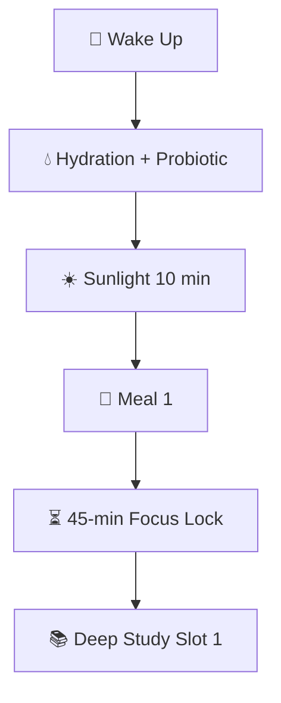

# 📝 Advanced Obsidian Markdown Syntax Reference

Obsidian extends CommonMark and GitHub Flavored Markdown (GFM) with powerful native features and formatting options. This reference covers advanced syntax for building high-performance, structured knowledge bases.

---

## 1. 💬 Callouts (Admonitions)

Obsidian natively supports Callouts using blockquote syntax with `[!type]`.

### Syntax Structure
```markdown
> [!TYPE] Optional Custom Title
> Callout body content.
> Can span multiple paragraphs.
```

### Supported Core Types & Chromatic Mapping
| Type | Default Color | Best Use Case |
| :--- | :--- | :--- |
| `note`, `seealso` | Blue | General reference, cross-linking |
| `tip`, `hint`, `important` | Cyan / Green | Actionable insights, study tips |
| `info`, `todo` | Blue / Purple | Informational context, task checklist |
| `warning`, `caution`, `attention` | Yellow / Orange | Prerequisites, cautions, edge cases |
| `failure`, `fail`, `missing` | Red | Errors, anti-patterns, what NOT to do |
| `danger`, `error` | Red | Critical warnings, destructive actions |
| `bug` | Red | Software bugs, known logic defects |
| `example` | Purple | Worked examples, code samples |
| `quote`, `cite` | Grey | Quotations, citations |
| `question`, `help`, `faq` | Yellow / Orange | Socratic questions, flashcards |
| `success`, `check`, `done` | Green | Milestones, verified outcomes |

### Foldable Callouts (Active Recall & Progressive Disclosure)
- **Collapsed by default (`-`)**: Essential for Active Recall (`> [!question]- ❓ Question`).
- **Expanded by default (`+`)**: Collapsible but visible on first load (`> [!info]+ Title`).

```markdown
> [!question]- ❓ What is the function of the sub-occipital muscles in study fatigue?
> Sub-occipital muscles stabilize the base of the skull. Forward head posture while looking down at books or screens causes chronic spasm, restricting blood flow and triggering cerebellar tension.
```

### Nested Callouts
Callouts can be nested inside one another by increasing blockquote depth `>>`:
```markdown
> [!note] Parent Hub Note
> This is the high-level overview.
> > [!tip] Child Action
> > This is a nested actionable tip inside the note.
```

---

## 2. 🔗 Internal Links, Embeds & Pipe Dimensions

### Wikilinks
- Standard link: `[[Note Name]]`
- Aliased link: `[[Note Name|Display Label]]`
- Heading link: `[[Note Name#Specific Heading]]`
- Block reference: `[[Note Name#^blockid]]`

### File & Image Embeds
- Embed whole note: `![[Note Name]]`
- Embed image: `![[photo.jpg]]`
- Embed image with width: `![[photo.jpg|300]]`
- Embed image with width & height: `![[photo.jpg|300x200]]`
- Audio / Video embeds: `![[audio.mp3]]`, `![[clip.mp4]]`
- PDF page embeds: `![[document.pdf#page=4]]`

> [!danger] **Critical Table Syntax Rule**
> Inside Markdown tables, **NEVER** escape the pipe inside an embed as `![[image.jpg\|300]]`. 
> Backslashing the pipe breaks Obsidian's link resolver, causing Obsidian to search for a file named `image.jpg|300`. 
> Obsidian's native parser correctly processes `![[image.jpg|300]]` inside table cells without escaping.

---

## 3. 📊 Advanced Tables

Obsidian supports GFM tables and native alignment.

```markdown
| Left-aligned | Center-aligned | Right-aligned |
| :--- | :---: | ---: |
| Text | Number | Currency |
| Data A | 42 | ₹150.00 |
```

For rich table editing:
- Use `<br>` for line breaks inside cells.
- Use emojis for rapid visual scanning.
- Use Wikilinks inside table cells: `[[Daily_Routine_Flow_Guide|Routine]]`.

---

## 4. 🧮 LaTeX Math & Chemical Formulas (KaTeX)

Obsidian renders math natively using KaTeX.

### Inline Math: `$ ... $`
```markdown
The Pythagorean theorem states that $a^2 + b^2 = c^2$.
```

### Display / Block Math: `$$ ... $$`
```latex
$$
\sigma = \sqrt{\frac{1}{N} \sum_{i=1}^{N} (x_i - \mu)^2}
$$
```

---

## 5. 🖼️ Banners & Visual Covers (YAML)

When using `obsidian-banners` or `pixel-banner`:
```yaml
---
banner: "Attachments/Master_Cover.jpg"
banner_x: 0.5
banner_y: 0.35
banner_icon: 💎
---
```

---

## 6. 🖍️ Inline Highlights & Chromatic Formatting

- Native text highlight: `==highlighted keyword==`
- Strikethrough: `~~deprecated point~~`
- Bold + Italic: `***essential core trigger***`
- Footnotes:
  ```markdown
  This statement is backed by neuroscience[^1].

  [^1]: Huberman Lab Podcast Ep. 12 (Dopamine Dynamics).
  ```

---

## 7. 🧜 Mermaid Diagrams

Obsidian renders Mermaid natively inside ` ```mermaid ` code blocks.



---

## 8. 🏷️ Tags & Frontmatter (YAML Properties)

Standard YAML frontmatter format:
```yaml
---
title: "Document Title"
aliases: ["Alt Name", "Short Name"]
date: 2026-10-25
tags:
  - mindset
  - cognitive
  - protocol
status: active
type: hub
---
```
Always use valid YAML syntax (keys lowercase or snake_case, lists indented with 2 spaces).
